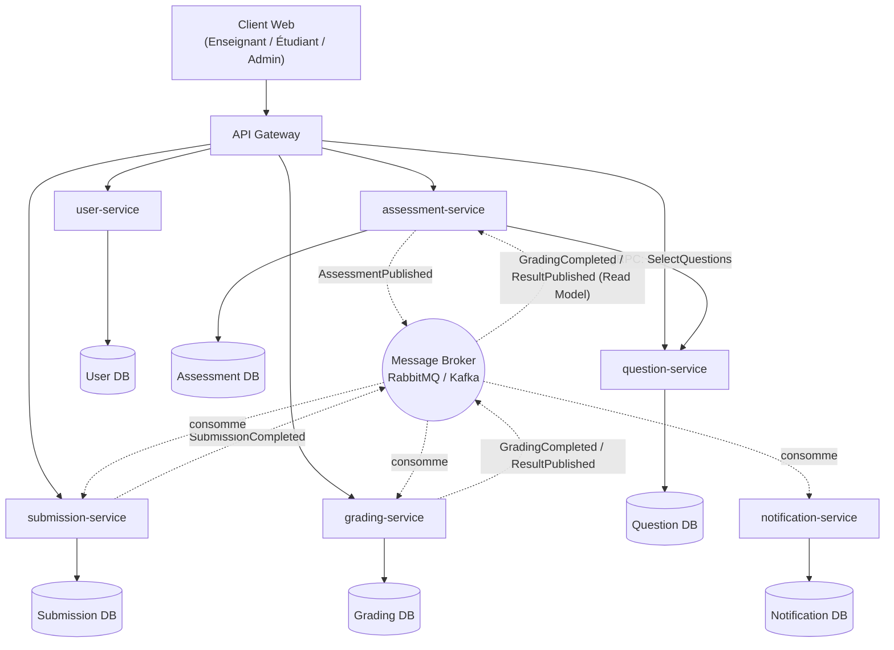
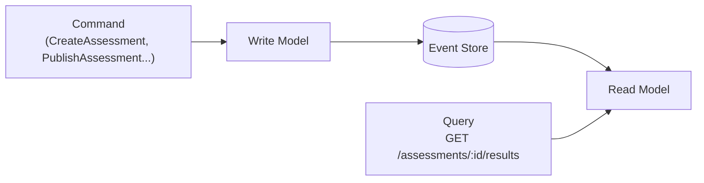

# Architecture — Plateforme de gestion des évaluations

## Vue d'ensemble



- **Traits pleins** : communication synchrone (REST via l'API Gateway, gRPC
  entre `assessment-service` et `question-service`).
- **Traits pointillés** : communication asynchrone via le broker de
  messages (publication/consommation d'événements).
- **Bases de données** : une base par service, aucune base partagée.

## Flux principal (parcours nominal)

1. L'enseignant crée des questions (`question-service`, REST).
2. L'enseignant crée une évaluation ; en génération automatique,
   `assessment-service` appelle `question-service` en **gRPC**
   (`SelectQuestions`).
3. L'enseignant publie l'évaluation → `assessment-service` publie
   `AssessmentPublished` sur le broker.
4. `submission-service` consomme l'événement et ouvre l'accès à
   l'évaluation pour les étudiants inscrits.
5. L'étudiant réalise l'évaluation et soumet ses réponses (REST) →
   `submission-service` publie `SubmissionCompleted`.
6. `grading-service` consomme l'événement, effectue la correction
   automatique puis publie `GradingCompleted`.
7. Pour les questions ouvertes, l'enseignant complète la correction
   manuelle via `grading-service` (REST), puis publie `ResultPublished`.
8. `notification-service` consomme tous les événements ci-dessus et
   notifie les utilisateurs concernés.

## Saga : Soumission → Correction → Notification

Modèle **chorégraphié** : chaque service réagit aux événements sans
coordinateur central (cohérent avec le faible nombre de services et
l'objectif pédagogique de montrer le couplage faible par événements).

```
SubmissionCompleted → grading-service (correction auto)
                          │
                          ▼
                  GradingCompleted / ResultPublished
                          │
                          ▼
                  notification-service (notifie l'étudiant)
```

**Compensation** (implémentée) :

- **Soumission hors délai** : `submission-service` passe la copie en
  `REFUSEE_HORS_DELAI`, ne publie pas `SubmissionCompleted` (aucune
  correction n'est déclenchée) et publie `submission.rejected` ;
  `notification-service` prévient l'étudiant.
- **Correction automatique impossible** (service distant injoignable) :
  `grading-service` garde la copie `EN_ATTENTE` et la relance
  périodiquement. Après `GRADING_MAX_ATTEMPTS` échecs, la copie passe en
  `ECHEC_CORRECTION` et `grading-service` publie `grading.failed` :
  `submission-service` signale l'incident sur la copie
  (`incidentCorrection`) et `notification-service` prévient l'étudiant et
  l'enseignant. L'enseignant relance la correction
  (`POST /gradings/:id/retry`) ; quand elle aboutit, `grading.completed`
  efface l'incident côté `submission-service`.

```
SubmissionCompleted → grading-service ──(échecs répétés)──▶ grading.failed
                                                            │
                       ┌────────────────────────────────────┤
                       ▼                                    ▼
        submission-service (incident)          notification-service
```

**Resoumission autorisée** (règle métier 3) : l'enseignant responsable
rouvre une copie soumise ou refusée hors délai
(`POST /submissions/:id/reopen`, avec une date limite propre à la copie si
l'évaluation est terminée). `submission-service` la repasse `EN_COURS` et
publie `submission.reopened` : `grading-service` supprime la correction non
validée (la nouvelle soumission en recrée une), `notification-service`
prévient l'étudiant. `submission-service` connaît l'enseignant responsable
par `assessment.published` et refuse la réouverture dès qu'il a reçu
`result.published` pour la copie. `submission.reopened` et
`submission.completed` arrivent sur la même queue de `grading-service`,
donc dans l'ordre.

```
POST /reopen → submission-service ──▶ submission.reopened
                                            │
                       ┌────────────────────┤
                       ▼                    ▼
     grading-service (correction       notification-service
     abandonnée)                       (prévient l'étudiant)
```

## CQRS + Event Sourcing (assessment-service)



- **Write Model** : traite les commandes, valide les règles métier
  (ex. impossible de publier une évaluation sans questions).
- **Event Store** : conserve l'historique des événements
  (`AssessmentCreated`, `AssessmentPublished`, `AssessmentClosed`...).
- **Read Model** : reconstruit à partir des événements, optimisé pour la
  consultation des résultats par l'enseignant et l'étudiant.

## Convention de messaging (RabbitMQ)

Défini par `assessment-service` (premier producteur/consommateur
implémenté) ; à réutiliser par les autres services pour rester
interopérables :

- **Exchange** : `evaluations.events`, type `topic`, durable
- **Routing keys** (une par événement métier) :
  - `assessment.published`, `assessment.closing_soon` — publiés par
    `assessment-service`
  - `submission.completed`, `submission.rejected` (copie refusée hors
    délai, règle métier 2), `submission.reopened` (resoumission autorisée,
    règle métier 3) — publiés par `submission-service`
  - `grading.completed`, `result.published`, `grading.failed`
    (compensation) — publiés par `grading-service`
- **Payload** : JSON, contient toujours `assessmentId` et, le cas échéant,
  `etudiantId`
- Chaque service consommateur déclare sa propre queue durable et la lie
  aux routing keys qui l'intéressent (ex. `assessment-service` lie
  `assessment-service.grading-events` à `grading.completed` et
  `result.published`)
- **Dead-letters** : un message dont le traitement échoue n'est plus
  perdu. Il est copié dans `<queue>.dead-letters` (en-têtes
  `x-routing-key`, `x-error`, `x-failed-at`) puis acquitté ; on peut
  l'inspecter et le rejouer depuis l'interface d'administration RabbitMQ
- Connexion tolérante aux pannes : si le broker est indisponible au
  démarrage, le service continue de fonctionner en REST (avertissement en
  log), sans bloquer sur la messagerie

## Contrats d'API

Voir `docs/openapi/` (à compléter au Sprint 1) pour les spécifications
OpenAPI/Swagger de chaque service REST. Contrats gRPC dans
`docs/protos/`.
